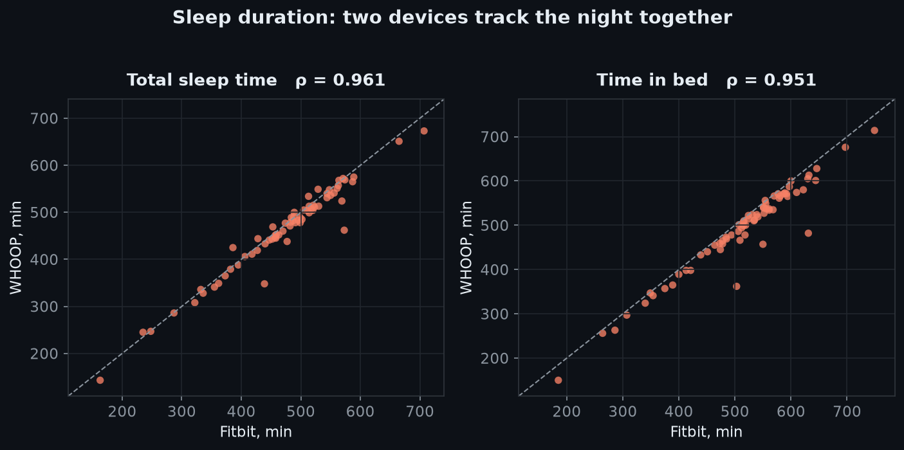
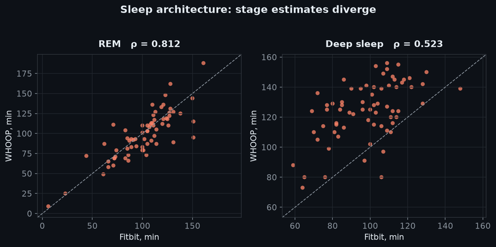
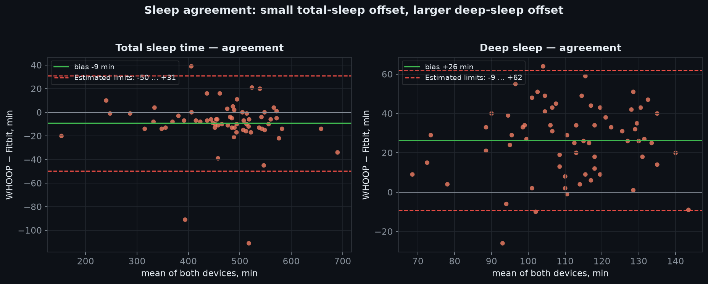
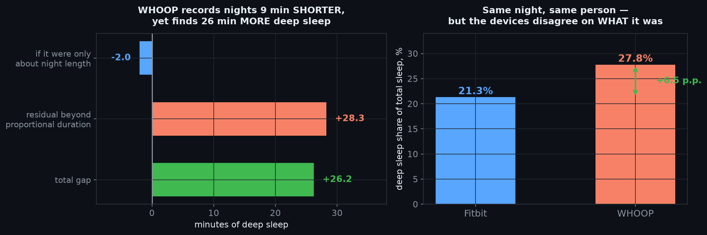
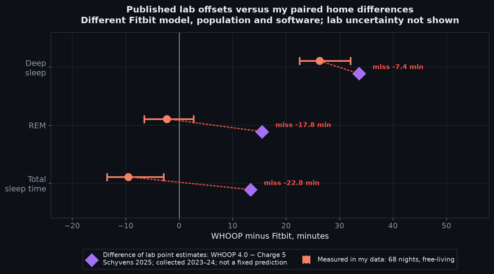
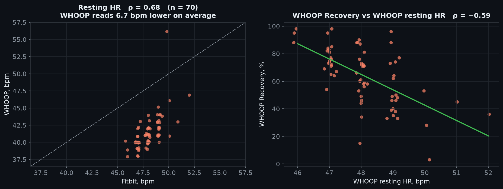
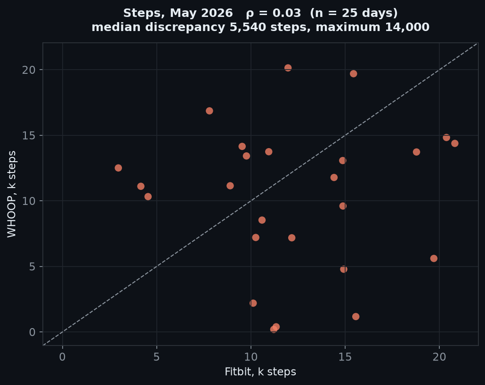
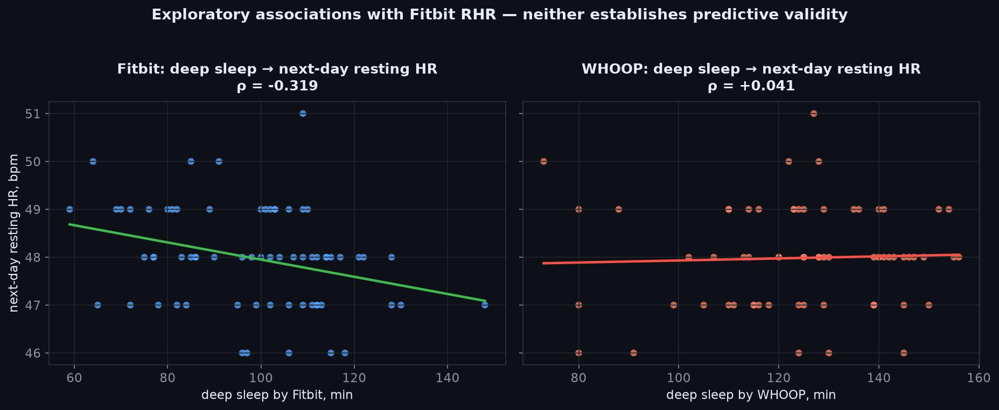

# Fitbit and WHOOP agree on the night—but not on deep sleep

## What I found

In autumn 2025, I wore a Fitbit Charge 6 and a WHOOP 4.0 on different wrists. Both fed into my own analytics system, [OptiHealth](https://optihealth.devpins.org), so I could compare the numbers rather than my impressions. I repeated the source-separated comparison in spring 2026, using the WHOOP account and data available in that window.

The paired sleep data cover **68 staged nights from 11 October to 23 December 2025**, plus a wider source-separated P1 window with **70 paired main-sleep sessions from 8 October to 24 December 2025**. The second window covers **28 Fitbit main sleeps** from 22 April to 28 May 2026 and **17 paired WHOOP main sleeps plus one nap in May** from source **2757**. The two WHOOP account identities are retained as separate cohorts rather than pooled.

The short version: **the devices track changes in sleep duration closely, but disagree substantially about how much of the night was deep sleep.** WHOOP Strain is a different question: it needs to be judged as an intensity–duration load, not as an expensive step counter. And the software was not necessarily the same across the two wear windows.

### Data and provenance

The analysis uses OptiHealth `sleep_sessions`, `metric_daily`, `metric_samples` and `workouts`, keeping source IDs separate. Fitbit/Google Health is source **35**; the autumn WHOOP account is source **2754**; the May WHOOP account is source **2757**.
The windows contain:

- **P1 (8 October–24 December 2025):** 71 Fitbit main sleeps, 74 WHOOP main sleeps, 70 timestamp-paired nights; two naps from each source.
- **P2 (22 April–28 May 2026):** 28 Fitbit main sleeps and **17 WHOOP main sleeps plus one nap during 1–28 May** from source 2757. The separate WHOOP source 2754 has no sessions in this window, so the two source identities are not pooled.
- WHOOP's sleep-session record does not populate `latency_min` or `awakenings`. Its separate `whoop_sleep_disturbance_count` series is available for the P1 nights and is analyzed below; it is a WHOOP disturbance metric, not the same field as Fitbit awakenings.
- Onset clock time is a separate variable from latency: a later sleep start does not mean it took longer to fall asleep.

The paired analysis keeps the two WHOOP account identities separate: P1 uses source **2754**, while the May 2026 cohort uses source **2757**. Differences below are **WHOOP minus Fitbit**; `n` is metric-specific.

| Cohort | Metric | n | Fitbit mean | WHOOP mean | WHOOP − Fitbit | MAE |
|---|---|---:|---:|---:|---:|---:|
| P1 | Awake minutes | 70 | 40.3 min | 27.8 min | **−12.6 min** | 15.6 min |
| P1 | Sleep efficiency | 70 | 92.2% | 94.4% | **+2.25 pp** | 2.84 pp |
| P1 | Light sleep | 70 | 274.9 min | 239.8 min | **−35.0 min** | 37.5 min |
| P1 | Deep sleep | 70 | 98.0 min | 124.7 min | **+26.7 min** | 28.1 min |
| P1 | REM sleep | 70 | 101.4 min | 98.4 min | **−3.0 min** | 12.8 min |
| P1 | Time in bed | 70 | 515.1 min | 490.4 min | **−24.7 min** | 24.7 min |
| May 2026 | Awake minutes | 17 | 29.4 min | 33.4 min | **+4.1 min** | 4.1 min |
| May 2026 | Sleep efficiency | 17 | 92.4% | 92.4% | **+0.1 pp** | 1.4 pp |
| May 2026 | Light sleep | 4 | 324.5 min | 276.0 min | **−48.5 min** | 48.5 min |
| May 2026 | Deep sleep | 4 | 93.0 min | 132.3 min | **+39.3 min** | 39.3 min |
| May 2026 | REM sleep | 4 | 101.5 min | 94.0 min | **−7.5 min** | 11.0 min |
| May 2026 | Time in bed | 17 | 458.4 min | 457.8 min | **−0.5 min** | 1.5 min |

WHOOP latency and awakenings are unavailable in the stored sleep-session record in both cohorts; they are not zeros. The May stage rows use only four paired nights because the other 13 Fitbit rows contain `unknown`/`awake` epochs and stored zero stage totals, which are treated as missing stage information rather than measured zero sleep.

WHOOP can look better even while reporting slightly less total sleep. In the P1 pairing, WHOOP's sleep window is shorter (**490.4 vs Fitbit 515.1 min**), contains less awake time (**27.8 vs 40.3 min**), and therefore has higher efficiency (**94.4% vs 92.2%**). The paired-export total-sleep means are **463.5 min for WHOOP vs 473.0 for Fitbit**—so WHOOP is not actually reporting more total sleep; it is reporting a shorter, cleaner sleep interval. Fitbit's lower score impression comes mainly from its longer window and larger awake component, not from a lower total-sleep estimate. In the May cohort, the boundary metrics are much closer: **457.8 vs 458.4 min in bed**, **92.4% vs 92.4% efficiency**, and **33.4 vs 29.4 awake minutes**.

That is probably the central subjective effect: WHOOP makes the night look more efficient, while Fitbit exposes more of the time spent in bed awake. This is a difference in measurement boundaries and classification, not just a difference in the headline score. WHOOP stage values are provider totals, not an aligned epoch-by-epoch hypnogram. The reproducible audit is in `analysis/sleep_reaudit/`.

---

## 1. Sleep duration: close tracking is not perfect agreement

| Measure | Fitbit mean | WHOOP mean | Spearman correlation |
|---|---:|---:|---:|
| Total sleep time | 473.0 min | 463.5 min | **ρ = 0.961** |
| Time in bed | 513.8 min | 491.2 min | ρ = 0.951 |

| Measure | Fitbit mean | WHOOP mean | Spearman correlation |
|---|---:|---:|---:|
| REM sleep | 101.2 min | 98.9 min | ρ = 0.812 |
| **Deep sleep** | **98.2 min** | **124.4 min** | **ρ = 0.523** |

When one device records a longer night, the other usually does too. WHOOP also places the start of the night about **18 minutes later**, on average. The May paired cohort shows the same close boundary agreement—**458.4 min in Fitbit versus 457.8 min in WHOOP**—rather than the larger P1 boundary difference.

The devices move together on total sleep, but stage totals diverge sharply: the same correlation can coexist with a practically large deep-sleep offset.

---

## 2. Deep sleep: a stage-specific offset, not a longer night

WHOOP reports **26.3 more minutes of deep sleep in P1**, despite recording a shorter night. In the May cohort, WHOOP reports **39.3 more minutes** on the **four** paired nights where Fitbit stage totals are actually available; the other 13 Fitbit stage records are semantically missing. The estimated P1 limits are **−9.4 to +61.9 minutes** for deep sleep and **−49.8 to +30.9 minutes** for total sleep. Total-sleep correlation therefore hides a large stage-specific offset in both source-separated cohorts.

The obvious explanation—“WHOOP simply thinks the night was longer”—is wrong for P1 in the literal sense: WHOOP reports **less total sleep** and **less time in bed**. The better explanation is a **segmentation difference** in that cohort. WHOOP assigns a shorter sleep window, fewer awake minutes and higher efficiency; Fitbit includes more awake structure inside a longer window. Fitbit's timeline has 1.46 interior awake runs per night, while WHOOP's export stores no equivalent awake-run timeline. The devices are therefore not merely disagreeing about duration—they are deciding differently which parts of the night count as sleep, wake and boundary time.

---

## 3. A laboratory bias is not a universal correction

Schyvens and colleagues compared consumer wearables against polysomnography in a study of **62 adults**. Their data were collected **from April 2023 to August 2024**, although the paper was published in 2025. Participants wore **two to four devices simultaneously**, not just one. The usable samples differed by device: **39 for Fitbit Charge 5 and 40 for WHOOP 4.0**.[13]

The paper reported a deep-sleep bias of **+31.49 minutes for WHOOP 4.0** and **−2.19 minutes for Fitbit Charge 5**. Subtracting those point estimates gives a reference gap of **+33.68 minutes**.[13]

| Measure | Difference of published biases, WHOOP−Fitbit Charge 5 | My WHOOP−Fitbit Charge 6 difference | My 95% block-bootstrap CI |
|---|---:|---:|---:|
| Deep sleep | +33.7 min | **+26.3 min** | +22.5 to +32.0 |
| REM | +15.5 min | **−2.3 min** | −6.5 to +2.7 |
| Total sleep | +13.3 min | **−9.5 min** | −13.5 to −2.9 |

The deep-sleep offset has the same direction and broadly similar magnitude, while total sleep reverses sign and REM is close to zero. Treat these as a useful external comparison, not a calibration table: the lab used Charge 5, my data use Charge 6, the populations and software differ, and the study's uncertainty is not included in my intervals.[13]

The practical lesson is simple: do not subtract a published average bias from a personal wearable history and call the result corrected.

---

## 4. WHOOP Strain versus Fitbit activity

WHOOP Strain is an internal-load score built from proprietary cardiovascular and, for supported activities, muscular-load signals. It should not be treated as Banister TRIMP rescaled to 0–21, or as a step/calorie counter.

### Strain and activity data

The direct database audit is the result used here. In P1, WHOOP source 2754 Day Strain correlates with Fitbit source 35 at **ρ = +0.046 for steps (n=74)**, **+0.089 for moderate minutes (n=67)**, **−0.020 for vigorous minutes (n=67)**, and **+0.091 for total calories (n=74)**. Fitbit active calories were not present in P1.

P2 uses WHOOP source **2757**, while source 2754 has no P2 sleep rows. Against Fitbit source 35, P2 Strain correlations are **+0.159 with steps (n=34)**, **−0.141 with moderate minutes (n=33)**, **−0.065 with vigorous minutes (n=33)**, **+0.063 with active calories (n=26)**, and **−0.060 with total calories (n=34)**. A separate-source P2 steps result (`ρ = +0.778`, n=25) is excluded.

The paired activity export contains **1,871,522 Fitbit HR points in P1** and **1,336,282 non-WHOOP HR points in P2**. In these OptiHealth exports, the WHOOP source has no raw `hr` series: it has daily resting HR, Recovery and Strain, plus sparse HRV, respiratory-rate, SpO₂ and temperature samples. There is therefore no direct intraday WHOOP–Fitbit pulse comparison or timestamped WHOOP HR-load reconstruction here.

The calendar-lag analysis remains useful: max workout Strain is `ρ = −0.198` on the same date and `ρ = +0.788` when paired to the previous calendar day. That is an alignment signal, not a corrected answer. The detailed source inventory and figures are in `analysis/activity_reaudit/`.

---

## 5. Recovery overlaps with resting heart rate

Recovery correlates with Fitbit resting HR at **ρ = −0.59** across 70 days. The engine results below add stronger relationships with nocturnal HRV and HR.

---

## 6. Steps: the exported records disagree

From **1 to 28 May 2026**, the historical Health Connect CSV export contains **25 paired days**. The step-count correlation is **ρ = 0.03**. The median absolute difference is **5,540 steps**, with discrepancies of roughly 14,000 on some days.

The May step result is a source-specific export result, not a universal Fitbit-versus-WHOOP algorithm result: the source analysis finds multiple Fitbit/Health Connect sources and WHOOP source 2757 in P2, while WHOOP source 2754 has no P2 sleep rows.

---

## 7. Component metrics explain more than the headline score

WHOOP Recovery combines HRV, sleep RHR, respiratory rate, sleep quantity/quality, SpO₂ and related signals.[17] Its sleep model includes duration, awake/light/deep/REM time, cycles, disturbances, performance, consistency and efficiency.[16] The available local export contains only a subset of these fields.
### Sleep fragmentation

Fitbit's stage timeline contains **104 interior awake runs across 71 P1 nights**: **1.46 interior runs/night**, with a median duration of **10.5 minutes** (range 5–64.5). Fitbit reports **40.3 awake minutes** per night versus **27.8** for WHOOP on the 70 paired nights. Fitbit's awakening count averages **3.36/night**; WHOOP's separate disturbance count averages **11.33/night** (median 11, range 2–19).

Fitbit's timeline does contain six ≤2-minute awake runs, but all occur at sleep boundaries; the shortest interior run is 5 minutes. So the data support more Fitbit fragmentation, not a large count of tiny remembered/unremembered middle-of-night events. WHOOP's disturbance count is a different event definition: across the 70 paired days it has essentially no rank relationship with Fitbit awakenings (`ρ = −0.011`).

The Fitbit latency estimate is **15.2 min mean, 14 min median, 68/71 nights** in P1; WHOOP sleep-session latency and awakening fields are absent, while disturbance count is available separately. In P2, Fitbit latency is available on 17/28 source-35 nights; source 2754 has no sessions, and the 17 source-2757 May pairs likewise have no WHOOP latency or awakening values.

### Pulse: the daily view is a lossy summary

The daily Strain export contains Fitbit mean HR, 95th-percentile HR, maximum HR and minutes above 100, 120 and 140 bpm. Fitbit active-calorie values are completely missing in this table, so I do not replace them with total calories or invent an estimate. The local WHOOP export likewise does not include respiratory rate, sleep-score components, sleep need, or disturbance counts; those are documented fields, not silently reconstructed variables.[16]

The nightly table adds another useful distinction: WHOOP sleep RHR and Fitbit RHR correlate at **ρ = +0.668** (n = 65), while WHOOP reports a lower level on average. WHOOP Day Strain is also only weakly related to Fitbit steps (**ρ = +0.066**), MVPA (**ρ = +0.058**), total calories (**ρ = +0.091**) and vigorous minutes (**ρ = −0.034**). Those are not contradictions: steps, calories and minutes above a threshold are external or partial summaries, whereas Strain is intended to represent physiological load.

### WHOOP Strain versus Fitbit activity: the complete local comparison

| Fitbit or activity comparator | Spearman ρ with WHOOP Day Strain | Complete days |
|---|---:|---:|
| Total calories | +0.091 | 74 |
| Steps | +0.066 | 74 |
| Moderate minutes | +0.089 | 67 |
| Vigorous minutes | −0.034 | 67 |
| MVPA (moderate + vigorous) | +0.058 | 74 |
| Daily mean HR | +0.204 | 73 |
| Daily HR p95 | +0.079 | 73 |
| Daily HR maximum | +0.165 | 73 |
| Minutes HR >100 bpm | +0.026 | 73 |
| Minutes HR >120 bpm | +0.103 | 73 |
| Minutes HR >140 bpm | +0.111 | 73 |
| WHOOP workout minutes | +0.120 | 71 |
| WHOOP workout-session count | +0.170 | 71 |
| WHOOP workout-kcal total | −0.087 | 64 |
| WHOOP maximum workout Strain | −0.172 | 64 |

The provocative result is not “WHOOP Strain is fake.” It is that the **available daily summaries are poor observables of a nonlinear, interval-based score**. The next experiment should use timestamped HR, exact cycle boundaries, workout start/end times, and activity type. Until then, the honest conclusion is limited: Strain does not behave like steps, calories, or any one Fitbit daily pulse statistic in this export.

---

## 8. Deep sleep and next-day resting HR

The outcome was tested separately for each device, not only against Fitbit:

| Sleep predictor | Next-day outcome | n | Spearman ρ | Block-permutation p |
|---|---|---:|---:|---:|
| Fitbit deep sleep | Fitbit RHR | 67 | **−0.319** | 0.0060 |
| WHOOP deep sleep | Fitbit RHR | 67 | +0.041 | 0.7211 |
| Fitbit deep sleep | WHOOP RHR | 65 | **−0.239** | 0.0589 |
| WHOOP deep sleep | WHOOP RHR | 65 | −0.050 | 0.7052 |

The original asymmetry is therefore outcome-specific: Fitbit deep sleep has its strongest association with next-day Fitbit RHR, a weaker association with next-day WHOOP RHR, and WHOOP deep sleep is near zero for both outcomes. The complete matrix is in `analysis/results_sleep_predictive_matrix.json`.

The engine turns the comparison into a measurement-system question: agreement, physiological coherence, and prediction are separate properties.

- Deep-sleep agreement is **ρ = 0.523**; it shows disagreement, not a reliability coefficient.
- On 44 common activity days, Fitbit logged **202 sessions** and WHOOP **144**; session count was `ρ = +0.492`, while workout calories were `ρ = +0.108`.
- The lag analysis gives **ρ = −0.198** for same-day max workout Strain and **+0.788** when paired to the previous calendar day. That is the key alignment result.
### Engine context

The two-year OptiHealth analysis window spans **12 October 2024–12 October 2026**. It provides cross-card context for the paired experiment.

The engine links WHOOP Recovery to the same physiological channels that appear in the component data:

| Current OptiHealth card | Calendar-adjusted association | After seasonal adjustment | Days |
|---|---:|---:|---:|
| Nocturnal HRV RMSSD → WHOOP Recovery | +0.75 | +0.76 | 89 |
| HR minimum → WHOOP Recovery | −0.61 | −0.67 | 93 |
| Respiratory-rate minimum → WHOOP Recovery | −0.54 | −0.61 | 94 |
| Resting HR → WHOOP Recovery | −0.49 | −0.42 | 94 |
| WHOOP Recovery → total sleep duration | +0.35 | +0.38 | 94 |
| HR maximum → workout maximum HR | +0.69 | +0.66 | 173 |
| Daily HR → workout session count | +0.51 | — | 90 |
| Daily HR → workout duration | +0.48 | — | 90 |
| HR maximum → Banister TRIMP | +0.41 | +0.40 | 173 |

These cards place Recovery in the same HRV/HR/respiratory-rate network as the component data. The latency card adds a concrete hypothesis: higher workout-average HR precedes higher sleep latency three days later (`r = +0.48`, `n = 61`).

The engine also found three cross-domain episodes in the article window:

- **3 December 2025:** total sleep 288 vs 487 minutes, REM 29 vs 105, efficiency 84.4% vs 93.5%, respiratory rate 14.5 vs 13.4.
- **14–16 December 2025:** respiratory rate 17.0 vs 13.4 and resting HR 52 vs 48.
- **15–17 December 2025:** resting HR stayed elevated for three days, with higher respiratory rate and lower HRV RMSSD.

### WHOOP data types and the May window

The OptiHealth analysis window spans **2024-10-15–2026-10-15** and contains **516 cards**. The active WHOOP source is **2757**; source 2754 is inactive. The dataset contains daily cycle average HR, cycle maximum HR, cycle energy, Strain, Recovery and steps, plus P1 sleep-performance/consistency/efficiency, sleep-need components, disturbance count and workout HR-zone minutes.

| Current engine relationship | Calendar-adjusted r | Seasonal-adjusted r | n |
|---|---:|---:|---:|
| WHOOP cycle energy → Day Strain | +0.76 | +0.80 | 61 |
| WHOOP cycle max HR → Day Strain | +0.75 | +0.74 | 61 |
| WHOOP cycle average HR → Day Strain | +0.59 | +0.56 | 61 |
| Sleep consistency → Sleep Performance | +0.71 | — | 69 |
| Recovery → Sleep Performance | +0.47 | — | 69 |
| WHOOP sleep efficiency → Fitbit sleep efficiency | +0.46 | — | 69 |

The strongest new result is construct-level: WHOOP's cycle energy and cycle HR measures track its own Strain strongly. The new sleep fields also make the internal score explainable: consistency and efficiency are related to Sleep Performance instead of remaining opaque headline numbers.

The engine's one-day lag family adds a coherent load-to-need chain: Day Strain → next-day sleep need from Strain (`r = +0.99`, n=60), cycle energy → sleep need (`r = +0.81`), and cycle max HR → sleep need (`r = +0.71`). The curves section finds WHOOP-related curved-vs-linear fits for Strain/temperature and Recovery/respiratory rate, but no stable optimum; those cards are exploratory curve fits, not new thresholds.

### The analysis engine is also a measurement-system comparison

I also replayed the deployed OptiHealth engine twice in a non-destructive, source-isolated run over the same 730-day account window: Fitbit/Google Health sources 35 and 49 versus WHOOP sources 744, 771, 2754 and 2757. The engine's own canonical source resolver was retained; I restricted its resolved source provenance to those groups rather than inventing a new priority rule. Both runs used the default engine configuration and completed with **zero module failures**. The Fitbit-isolated run produced **124 cards**; the WHOOP-isolated run produced **32**. Only **two exact card titles** appeared in both feeds. Fitbit produced a broad set of relationships involving sleep duration and stages, HR/HRV, respiration, activity, calories and VO₂ max. WHOOP produced fewer but more provider-specific chains: Recovery Score → Sleep Performance, Strain → next-day sleep need, and cycle energy/heart rate → sleep need. This is not evidence that Fitbit is four times more accurate. It is evidence that the engine's result is partly a property of the measurement system: changing the available channels changes which hypotheses are even testable. Card counts therefore cannot be used as a device-quality score; comparisons must be made on the same construct, with source provenance and missingness kept visible. The machine-readable output is `analysis/results_engine_source_isolation_2026-10-17.json`.

### May: WHOOP against hidden Fitbit physiology

For 1–28 May 2026, I compared the active WHOOP daily fields with Fitbit-derived hidden parameters that are not shown as ordinary user metrics: HR mean/min/max, HRV RMSSD mean/min/max, respiratory rate, SpO₂, body temperature and temperature deviation.

| WHOOP metric | Fitbit hidden parameter | Spearman r | n |
|---|---|---:|---:|
| Recovery | HR mean | −0.762 | 16 |
| Recovery | HRV RMSSD mean | +0.784 | 14 |
| Recovery | HRV RMSSD max | +0.808 | 14 |
| Recovery | SpO₂ mean | +0.487 | 17 |
| Cycle average HR | HRV RMSSD min | −0.655 | 19 |
| Cycle average HR | HR max | +0.551 | 21 |
| Cycle energy | body temperature mean | +0.548 | 22 |
| Cycle energy | HRV RMSSD min | +0.612 | 19 |
| Cycle energy | respiratory rate mean | −0.486 | 22 |
| Day Strain | respiratory rate mean | −0.520 | 22 |

The May data make Recovery's physiology much clearer: it moves inversely with Fitbit-derived HR and positively with Fitbit-derived HRV. Cycle energy is also linked to HRV, respiratory rate and temperature. These Fitbit-derived channels clarify the physiological components that sit behind the WHOOP scores.

The WHOOP sleep-performance and workout-zone series are present in P1 but not in the May window. The May cohort contains **17 source-2757 WHOOP sleep sessions plus one nap**, alongside cycle-level WHOOP data; it does not contain the full sleep-performance/zone series. The paired sleep and cycle data are therefore reported as distinct, explicitly named constructs.

The machine-readable audit is `analysis/current_whoop_reaudit_2026-10-15.json`.

---

## 10. Did the algorithms change between October and May

The timeline matters because the autumn and spring measurements may come from different software and activity models. WHOOP's July 2026 HR update is after both windows; the February 2026 update falls between them.

| Date or documented bound | Verified change | Relevance to my windows |
|---|---|---|
| **11 September 2024** | Google described a redesigned Fitbit Daily Readiness algorithm incorporating RHR alongside HRV and sleep.[8] | Predates both windows. It should not be misdated as an October 2025 release merely because a support page was updated then. |
| **By 2 May 2025** | A WHOOP staff reply described a sleep-staging update trained with more CQU/Arizona lab data and new signal interpretation.[12] | An update was already documented before my October start. The December recap is not evidence that this same update launched in December. |
| **By 6 October 2025** | WHOOP documented personalised HR-reserve zones for 4.0/5.0/MG, with Strain calculated independently of manual zone boundaries.[2] | Already documented before the first paired night. Personal calibration may evolve without a new algorithm release. |
| **2025, recapped 15 December** | WHOOP described an updated Sleep Performance score using sufficiency, consistency, efficiency, and stress, and its sleep-staging improvements.[6] | Confirms product evolution, but the recap alone does not date account-level rollout. Sleep Performance is not the same variable as minutes in a sleep stage. |
| **January 2026** | WHOOP lowered the minimum workout auto-detection duration from 15 to 10 minutes. On 8 January it expanded passive muscular-load estimation to rucking and Solidcore.[5] | Between windows; activity counts and supported Activity Strain can change without equivalent changes in behaviour. |
| **10–18 February 2026** | WHOOP shipped automatic muscular-load estimation for weightlifting, functional fitness, HIIT, and additional activity types.[5] | Between windows; relevant if those activity types were used. This expanded an existing muscular-load component rather than inventing it. |
| **25 February 2026** | WHOOP's release log records a new HR signal-processing algorithm, explicitly affecting the data behind Recovery, Strain, and Sleep.[5] | A genuine between-window measurement change. The entry does not establish my exact rollout date or explicitly resolve eligibility for my 4.0. |
| **17 March 2026** | Google announced an additional **15% increase in sleep-staging accuracy for Public Preview users**, with tracking rolling out over the following days and a redesigned Sleep Score to follow.[7] | Potentially relevant to April–May sleep. The percentage is Google's validation claim, not a measured improvement in me and not necessarily 15 percentage points. My Preview participation is unverified. |
| **22 April 2026** | WHOOP expanded automatic muscular-load estimation to 14 outdoor/adventure and labour activities, including rowing, climbing, skiing, and shovelling.[5] | On the first date in my second paired-sleep window; applies to the listed activities, not all daily movement. |
| **20 May 2026** | WHOOP updated workout auto-detection and classification, including strength work and lower-Strain sustained activity.[5] | Near the end of the second window; workout counts and labels need not be directly comparable with autumn. |
| **6 July 2026** | WHOOP's release log records another HR algorithm update.[5] | **After both windows. It cannot explain the October–May difference.** |

The 2023–2024 validation study, autumn 2025 measurements and spring 2026 measurements should be treated as different instrument versions unless account-level rollout records prove otherwise.

---

## What I take away

1. **Sleep duration moves together across the devices**, while stage totals diverge sharply. The May cohort also shows near-identical time in bed, even though its stage-complete subset shows a deep-sleep offset.
2. **Deep-sleep minutes are not interchangeable.** WHOOP averages 26.3 minutes higher in P1 and 39.3 minutes higher across the four May pairs with valid Fitbit stage totals.
3. **Sleep latency is a provenance finding.** Fitbit P1 latency averages 15.2 min on 68 nights; WHOOP latency is absent.
4. **Awakenings and pulse add context.** Fitbit reports 3.37 awakenings per P1 night; WHOOP wake events are absent.
5. **Strain requires interval and source-aware analysis.** P1 associations with Fitbit activity are weak; P2 is source-heterogeneous.
6. **Recovery tracks HRV, HR and respiratory rate** in the engine's component data.
7. **Source IDs and software versions belong in the comparison.**

## How this was analysed

The article combines CSV analysis with a read-only PostgreSQL extraction scoped to the user and preserving source IDs.

- CSV analysis: Spearman correlations, Bland–Altman summaries, moving-block bootstrap intervals and serial-aware exploratory tests.
- Database extraction: raw source-specific sleep pairing, Strain joins, workout/cycle dating, hidden Fitbit parameters and intraday HR coverage. Provider comparisons use the source-specific rows rather than canonical source arbitration; `unknown`/`awake`-only Fitbit stage epochs are treated as unavailable.
- No HR-load value is reported without timestamped WHOOP HR.
- `analysis/results_expanded_metrics.json`, `analysis/sleep_reaudit/`, `analysis/activity_reaudit/` and `analysis/current_whoop_reaudit_2026-10-15.json` contain the reproducible outputs.
## Sources

[1] https://www.mdpi.com/2227-7080/11/3/79
[2] https://support.whoop.com/s/article/What-is-Max-Heart-Rate-and-How-Do-I-Adjust-It
[3] https://www.whoop.com/us/en/thelocker/how-does-whoop-strain-work-101
[5] https://www.whoop.com/us/en/thelocker/2026-whats-new
[6] https://www.whoop.com/us/en/thelocker/everything-whoop-launched-in-2025
[7] https://blog.google/products-and-platforms/devices/fitbit/fitbit-personal-health-coach-updates-2026
[8] https://blog.google/products-and-platforms/devices/fitbit/pixel-watch-3-daily-readiness-update-cardio-target-load
[11] https://www.whoop.com/us/en/press-center/whoop-introduces-strength-trainer-becomes-first-wearable-to-measure-muscular
[12] https://www.community.whoop.com/t/whats-new-in-whoops-sleep-staging-algorithm-update/321
[13] https://pmc.ncbi.nlm.nih.gov/articles/PMC12038347
[16] https://developer.whoop.com/docs/developing/user-data/sleep — WHOOP Sleep API
[17] https://support.whoop.com/s/article/WHOOP-Recovery?language=en_US — WHOOP Recovery
