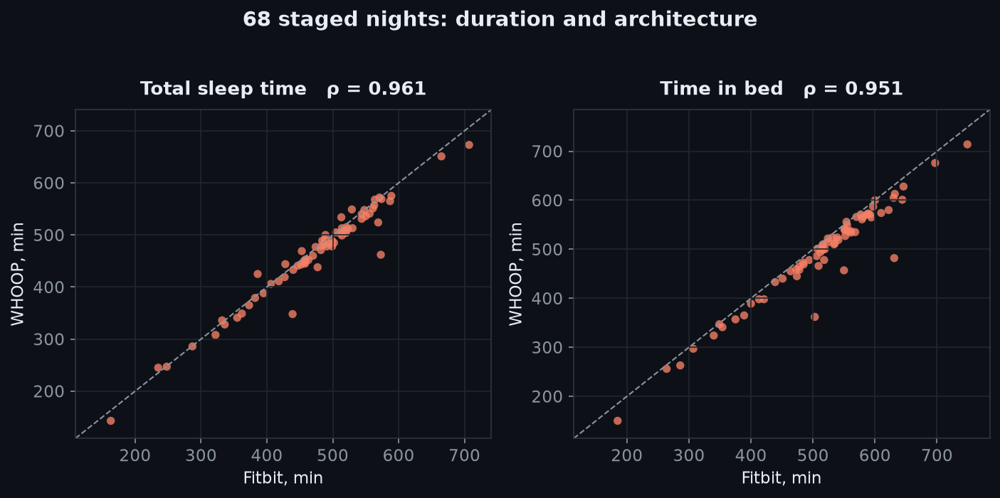
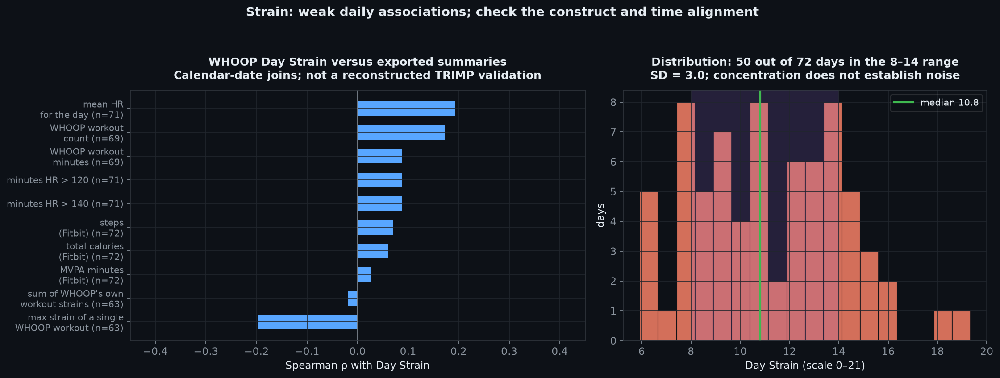

# Я носил Fitbit и WHOOP одновременно 68 ночей

## Что получилось

Осень 2025, два прибора на разных запястьях, каждую ночь. Все данные легли в мою же аналитику ([OptiHealth](https://optihealth.devpins.org)), так что можно было спокойно сравнить их между собой — не по ощущениям, а по числам.

Коротко: **длительность сна они меряют почти одинаково, а вот про то, ЧЕМ была ночь, спорят всерьёз.** И отдельный сюжет — Strain, главная метрика WHOOP, которая у меня не следует ни за одной измеримой нагрузкой.

---

## 1. Длительность — согласие почти идеальное

| | Fitbit | WHOOP | корреляция |
|---|---|---|---|
| Общее время сна | 473 мин | 463 мин | **ρ = 0.961** |
| Время в кровати | 514 мин | 491 мин | ρ = 0.951 |
| REM | 101 мин | 99 мин | ρ = 0.812 |
| **Глубокий** | **98 мин** | **124 мин** | **ρ = 0.523** |

Первые три панели — точки лежат на диагонали. Это ожидаемо: оба прибора считают движение акселерометром, а движение — физика, а не мнение.

Момент засыпания тоже совпадает почти идеально, хотя WHOOP в среднем решает, что ночь началась на **18 минут позже**.

А четвёртая панель выглядит иначе — почти все точки над диагональю.

---

## 2. Глубокий сон: +26 минут, и это не длинная ночь

WHOOP находит в среднем **на 26 минут больше глубокого сна**. Мои ощущения это подтверждали задолго до анализа — цифра глубокого у WHOOP всегда выглядела жирнее.

Правая панель показывает главное: **коридор согласия — 71 минута** (от −9 до +62). То есть в конкретную ночь один прибор может показать вдвое больше глубокого, чем другой. Для сравнения, по общему сну коридор вдвое уже и центрирован почти на нуле.

Очевидное объяснение — «WHOOP просто думает, что ночь была длиннее» — не работает:

WHOOP пишет ночь **на 9.5 минут КОРОЧЕ**. При доле глубокого у Фитбита (21.3%) более короткая ночь должна была дать **минус 2 минуты** глубокого. А наблюдается плюс 26.

Значит все 28 минут — это **переклейка стадий**. Одни и те же куски ночи один прибор называет лёгким сном, другой — глубоким. В долях: 21.3% против 27.8%.

Стоит держать в голове, что стадии сна вообще определяются по ЭЭГ. Прибор на запястье видит только пульс и движение и стадии **угадывает моделью**. Два разных классификатора — два разных мнения об одной ночи.

---

## 3. Лабораторная поправка не переносится

Тут получилось интересное. Есть валидационные исследования: человек спит ночь в лаборатории, на нём прибор и полисомнография (электроды, золотой стандарт). Меряют, на сколько прибор врёт.

Schyvens 2025 (n=62): по глубокому сну WHOOP 4.0 завышает на **+31.5 мин**, Fitbit Charge 5 занижает на **−2.2 мин**.

Отсюда следует предсказание: надев оба сразу, я должен увидеть разницу их ошибок, то есть **+33.7 мин**. **Проверить это в лаборатории невозможно** — там на человеке один прибор. Проверить может только тот, кто носил два одновременно много ночей.

| | лаборатория предсказала | у меня намерено |
|---|---|---|
| Глубокий | +33.7 мин | **+26.3** ✓ попала на 78% |
| REM | +15.5 мин | **−2.3** ✗ знак наоборот |
| Общий сон | +13.3 мин | **−9.5** ✗ знак наоборот |

По глубокому сну предсказание почти сбылось. А по общему сну **знак перевернулся**: лаборатория говорит «WHOOP пишет ночь длиннее», у меня он пишет короче. Применить опубликованную поправку — приборы разъедутся ещё дальше.

Моя догадка, почему так: глубокий сон — это работа **классификатора стадий**, она едет с прибором. А общее время сна — это работа **детектора границ ночи**, и в лаборатории границу задают снаружи («отбой»), а дома каждый прибор решает сам. Мои +18 минут расхождения по старту — ровно об этом.

---

## 4. Strain: число, которое не следует ни за чем

WHOOP Day Strain — шкала 0–21, вокруг которой построен весь продукт. По документации это логарифмическая мера кардионагрузки на базе времени в пульсовых зонах. Формула закрыта.

Я прогнал его против всего, что смог намерить (72 дня, два калибровочных дня в начале ношения выкинул):

| Против чего | ρ |
|---|---|
| Калории Fitbit | +0.06 |
| Шаги Fitbit | +0.07 |
| MVPA минуты | +0.03 |
| Минут пульс > 120 | +0.09 |
| Минут пульс > 140 | +0.09 |
| Минуты тренировок WHOOP | +0.09 |
| Средний пульс за день | +0.19 |
| **Сумма strain СВОИХ ЖЕ тренировок** | **−0.02** |
| **Макс strain своей тренировки** | **−0.20** |

Последние две строки — самое интересное. Дневной Strain не связан даже с суммой strain отдельных тренировок, которые посчитал сам WHOOP. Это не «разные приборы меряют по-разному» — это прибор не согласен сам с собой.

Правая панель объясняет почему: **50 дней из 72 зажаты в коридоре 8–14**, автокорреляция день-к-дню 0.05. То есть это почти белый шум в узком диапазоне. В дни без тренировок 8.6, в дни с тренировками 11.1 — разница есть, но при таком разбросе она тонет.

Честная оговорка: у меня низкий пульс покоя и мало высокоинтенсивной работы, 88 из 101 фитбит-сессии — ходьба. На узком диапазоне нагрузок корреляции и должны быть слабыми. Но ρ = −0.02 против собственных тренировок этим не объяснить.

---

## 5. Recovery — это перевёрнутый пульс покоя

Слева: пульс покоя, ρ = 0.68, но **все точки под диагональю** — WHOOP систематически ниже на 6.7 bpm. Приборы считают RHR по-разному (какое окно, ночь или сутки, какие фильтры), и это устойчивый сдвиг, а не шум.

Справа: WHOOP Recovery против пульса покоя Фитбита, **ρ = −0.59** на 70 днях. Флагманская метрика подписки во многом является трансформацией числа, которое отдаёт любой бесплатный трекер. Само по себе это не плохо — просто полезно знать.

---

## 6. Шаги

Май 2026, оба прибора отдают данные через Health Connect, 25 совпадающих дней. **ρ = 0.03.**

Медианное расхождение — 5540 шагов, в отдельные дни до 14 000. У WHOOP есть дни с 194 и 1173 шагами там, где Фитбит пишет 11–15 тысяч.

Шаги — самая простая метрика на любом приборе, и по ней согласия нет вообще.

---

## 7. Побочное наблюдение: только у одного прибора глубокий сон что-то предсказывает

Раз уж без полисомнографии нельзя сказать, кто прав, можно спросить иначе: **чьё число связано с независимой физиологией?**

Взял пульс покоя следующего дня — величину, которую ни один из стагеров не считает.

- Fitbit: глубокий сон → пульс покоя завтра, **ρ = −0.319**
- WHOOP: то же самое, **ρ = +0.041**

Направление у Фитбита физиологически правильное: больше глубокого — ниже пульс завтра. У WHOOP связи нет.

Осторожно с выводами: это одно наблюдение на одном человеке, я такое сравнение делал не одно, и при честной поправке на множественные сравнения эта находка порог не проходит. Считаю её поводом посмотреть ещё раз на следующем окне ношения, а не доказательством.

---

## Что я из этого вынес

1. **Длительности сна можно верить** — два независимых прибора сходятся на ρ = 0.96.
2. **Глубокому сну как абсолютному числу — нет.** Коридор в 71 минуту, и разница целиком в классификаторе. Смотреть имеет смысл на динамику внутри одного прибора, но не на цифру.
3. **Strain у меня бесполезен.** Не следует ни за нагрузкой, ни за собственными тренировками WHOOP.
4. **Recovery ≈ перевёрнутый RHR.** Работает, но это не магия.
5. **Шаги не сравнивать между приборами никогда.**
6. **Смена прибора ломает историю.** Пульс покоя сдвинется на 6.7 bpm, глубокий сон на 26 минут — и это будет выглядеть как изменение здоровья, хотя изменился только классификатор.

---

## Как считалось

Все числа — из живой базы, скриптами, ничего руками. Методы взял из движка OptiHealth:

- **Корреляция Спирмена** (по рангам, устойчива к выбросам)
- **p через блочную перестановку** — дневные ряды автокоррелированы, обычный p в такой ситуации завышает значимость. Режу на блоки по 5 дней, перемешиваю 2000 раз.
- **Доверительные интервалы блочным бутстрапом**, 20 000 пересборок
- **Bland–Altman** для согласия приборов
- Стадии проверял и в минутах, и в долях от ночи — минуты растут просто от длины ночи

Что значит каждая метрика — в [GLOSSARY.md](GLOSSARY.md).

**Ограничения.** n = 1, это про меня, а не про приборы вообще. Полисомнографии нет, поэтому «кто прав» я не знаю — только «они не могут быть правы оба». Запястья не менял местами. Второе окно ношения (апрель–май 2026) — всего 6 размеченных ночей, но направление то же: +37 минут глубокого. Oura подключена, но данных всего 5 ночей, в анализ не пошла.
